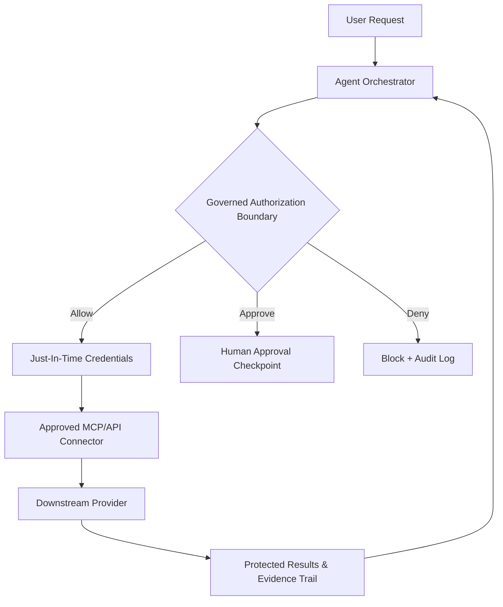

<!-- keywords: wiz ai agent security, zenity ai agent security, crowdstrike ai agent security, ai agent attack surface, mcp security, delegated oauth, least privilege ai agents, agentic runtime monitoring, jit access ai agents, ai agent incident response --> 

> **Quick Answer / TL;DR**
> 
> The rapid adoption of autonomous AI agents has drastically expanded the attack surface of modern environments. This lab walks through how to onboard an agent stack to **Wiz**, **Zenity**, and **CrowdStrike** to gain detection, runtime visibility, and alerting. By combining cloud posture, agentic application security, and endpoint/runtime telemetry with a policy-first authorization boundary, you can enforce least privilege without grinding agent utility to a halt. 


## What You Will Learn

- **Identify the threat model:** Learn the core attack surface for AI agents including identity, memory, tools, MCP connectors, and multi-step execution. 
- **Correlate telemetry:** Discover how to utilize Wiz, Zenity, and CrowdStrike together for layered **wiz ai agent security**, **zenity ai agent security**, and **crowdstrike ai agent security** coverage. 
- **Enforce a governed boundary:** Build a reference architecture that authorizes every tool call before provider access, with approval checkpoints and fail-closed behavior.
- **Implement a practical lab:** Step by step configuration, validation tests, and detection rules to alert on high-risk agent behavior.
- **Prepare for governance:** Learn about audit evidence, incident response, and regulated-industry considerations. 


## Table of Contents

- [1. The Evolving AI Agent Security Problem](#1-the-evolving-ai-agent-security-problem)
- [2. Mapping The AI Agent Attack Surface](#2-mapping-the-ai-agent-attack-surface)
- [3. Reference Architecture For A Governed Agent Stack](#3-reference-architecture-for-a-governed-agent-stack)
- [4. Enforcing Practical Controls](#4-enforcing-practical-controls)
- [5. Lab Implementation: Onboarding Wiz, Zenity, and CrowdStrike](#5-lab-implementation-onboarding-wiz-zenity-and-crowdstrike)
- [6. Testing, Monitoring, And Alerting](#6-testing-monitoring-and-alerting)
- [7. Governance, Evidence, And Incident Response](#7-governance-evidence-and-incident-response)
- [8. FAQ](#8-faq)
- [9. Further Reading](#9-further-reading)
- [10. Next Steps](#10-next-steps)


## 1. The Evolving AI Agent Security Problem

The industry has shifted from chat-based LLMs to goal-oriented AI agents that can reason, plan, and execute actions across cloud, SaaS, and internal systems. With this autonomy comes a new class of identity and execution risk. Traditional IAM, WAFs, and endpoint policies were not designed to evaluate a non-human agent chaining dozens of API calls to achieve a multi-step objective. 

This is where layered telemetry becomes crucial. By focusing on **wiz ai agent security** (cloud posture and data exposure), **zenity ai agent security** (agentic applications, prompts, and tool misuse), and **crowdstrike ai agent security** (endpoint, identity, and runtime behavior), security teams can correlate signals to detect compromise far before exfiltration occurs. 

_This sets the foundation for mapping out exactly where these tools can observe risk, which we will cover in the next section._


## 2. Mapping The AI Agent Attack Surface

Before onboarding any tooling, it is imperative to understand the areas that are most prone to abuse. Agents are uniquely vulnerable due to the coupling of reasoning and action. 

| Attack Surface | Description | Example Risk |
| :------------: | :----------: | :-----------: |
| **Identity** | The non-human identity (NHI) of the agent, often inherited from API keys or service accounts. | Privilege creep from over-scoped OAuth tokens. |
| **Prompts & Instructions** | System/user prompts, retrieved context, and instructions injected by external data. | Indirect prompt injection leading to unintended tool invocation. |
| **Memory** | Short and long term memory stores that can be poisoned over time. | Re-injection of malicious instructions across sessions. |
| **Tools & Connectors** | Functions, plugins, and MCP servers that allow the agent to take action. | Unvetted MCPs allowing arbitrary file writes or database queries. |
| **Credentials** | Secrets used to access downstream resources. | Hardcoded keys being logged or exfiltrated by a compromised agent. |
| **Data** | PII, source code, and secrets accessible to the agent's tools. | Over-broad retrieval causing sensitive data exfiltration. |
| **Multi-Step Execution** | Autonomous chaining of tools with no human-in-the-loop. | "Tool hopping", allowing an attacker to pivot across disconnected systems. | 

It is critical to note: observing these areas individually is not enough. These vectors compound against each other. With this attack surface in mind, we can now architect a policy boundary to contain it. 


## 3. Reference Architecture For A Governed Agent Stack

The most resilient approach for agentic environments is to enforce authorization *before* the agent is able to call a downstream provider. This is not exclusive to any singular vendor, but a general security principle. CodeCrux applies this governed-gateway approach using concepts such as distinct agent identity bound to a requesting human, delegated OAuth authorization with exact resource-bound grants, and policy decisions that allow, deny, or require scoped human approval. When implementing a lab, the goal should be to replicate this boundary of control regardless of the gateway that your organization evaluates.

Below is a reference architecture to model against: 



Key design tenets for this boundary include: 

- **Identity binding:** Bind the agent's action to the human principal that delegated it, creating traceable accountability.
- **Resource-bound delegation:** Utilize delegated OAuth grants that are as specific as possible (e.g, only read a singular bucket path), as opposed to broad scopes.
- **Just-in-time (JIT) access:** Issue credentials on-demand, keep them outside of the agent's persistent runtime where possible, and revoke them after use.
- **Approval checkpoints:** Require scoped human approval for high-risk actions (e.g, sending emails to external domains, deleting resources, or accessing regulated data).
- **Fail-closed behavior:** If the policy engine is unreachable or uncertain, default to deny.
- **Evidence trail:** Log every decision, tool call, arguments (sanitized), credential issuance, and result to an immutable store. 

With the architecture established, we can translate these tenets into enforceable controls. 


## 4. Enforcing Practical Controls

Now that the boundary has been defined, the following controls can be applied to the lab. These are vendor-agnostic by design, whilst still being verifiable by Wiz, Zenity, and CrowdStrike. 

| Control | Implementation Strategy | Verification Method |
| :------: | :----------------------: | :-----------------: |
| **Least Privilege** | Scope IAM roles, OAuth grants, and MCP function allowlists down to the minimum required resources. | Audit assigned permissions against executed tool calls. |
| **Delegated Identity** | Require agents to present a delegated token that references a human principal and task scope. | Correlate agent NHI to a human ID within audit logs. |
| **JIT Access** | Issue ephemeral credentials via a secrets broker at the moment of execution, revoking upon completion or timeout. | Alert on long-lived static keys being used by agent identities. |
| **Approval Checkpoints** | Create a policy-as-code list of "high impact" functions (e.g `send_email`, `write_to_prod_db`) that require approval. | Validate that blocked actions are correctly paused for review prior to execution. |
| **Input/Output Protection** | Sanitize prompts, filter retrieved RAG context for secrets, and redact sensitive data before returning it to the agent or user. | Test against known indirect prompt injection payloads. |
| **Containment** | Isolate the agent's network egress to approved destinations only, and restrict its filesystem access to sandboxed volumes. | Validate egress deny lists via runtime telemetry. | 

_These controls are only as strong as their observability. With them in place, it's time to onboard them to the detection stack for validation._


## 5. Lab Implementation: Onboarding Wiz, Zenity, and CrowdStrike

*Note: The following is a practical lab configuration. Feature availability changes rapidly, so always verify against the current primary sources for each vendor.* 

### 5.1 Onboard for **wiz ai agent security** (Cloud Posture & Data Exposure)

Wiz's strength within this scope is its ability to map identities, data, and attack paths across multi-cloud environments. For agentic workloads, focus on the non-human identities and the data stores that they can reach. 

```bash
# Example: Inventory agent-related NHIs via Wiz query (pseudocode)
# Look for service principals, API keys, and workload identities with unused or excessive permissions
wiz query "select * from identities where type = 'service_account' and last_used < '7d' and permissions_count > 15" --export-csv nhais_overprivileged.csv
```

**Implementation steps:**

1. **Identify agent identities:** Tag or filter NHIs that belong to your agent orchestrators (by project, workload ID, or Kubernetes service account).
2. **Map attack paths:** Utilize Wiz's attack path analysis to locate any path from an agent NHI to a sensitive data store (e.g, PII buckets, secret managers).
3. **Create posture alerts:** Create alerts for newly created NHIs, keys with no rotation, or NHIs gaining high privilege roles. 
4. **Correlate to data exposure:** Prioritize any finding where an over-scoped agent identity can access data that is externally shareable. 

### 5.2 Onboard for **zenity ai agent security** (Agentic Apps, Prompts, & Tools)

Zenity focuses heavily on securing agentic applications and their tool usage. This is particularly useful for detecting prompt injection, unauthorized function calls, and risky MCP usage. 

```yaml
# Example: Zenity policy guardrail concept (pseudocode)
policy_name: block_sensitive_file_access_via_mcp
trigger:
  app_type: "ai_agent"
  tool_name: "mcp_filesystem"
  action: "read"
condition:
  file_path_regex: "(?i)(secrets|\.env|private_key|prod_credentials)"
action:
  decision: "deny"
  reason: "Attempt to access secrets via MCP filesystem"
  alert_severity: "high"
  require_evidence: true
```

**Implementation steps:**

1. **Instrument the agent stack:** Onboard your orchestrator, agent runtime, and any published agents to Zenity, ensuring that tool calls and prompts are captured in a sanitized form.
2. **Build a tool allowlist:** Start in observe mode to learn legitimate tool usage, then transition high-risk tools to enforce mode.
3. **Guardrail against injection:** Enable rules to detect known indirect prompt injection patterns and data exfiltration intent from retrieved context.
4. **Alert on MCP sprawl:** Create alerts for the first time an agent utilizes an unapproved MCP server or function signature. 

### 5.3 Onboard for **crowdstrike ai agent security** (Runtime, Identity, & Endpoint)

CrowdStrike's telemetry (via Falcon) is invaluable to observe the agent's runtime footprint. For containerized or VM hosted agents, this allows for detection of process anomalies, malicious command execution, and suspicious network egress. 

```bash
# Example: Detection idea for suspicious agent process behavior (pseudocode)
# Alert if an agent process spawns a shell and attempts to reach an unapproved domain
rule:
  name: agent_shell_outbound_unapproved
  source: crowdstrike_falcon_events
  filter: 
    - process_image endswith "agent_orchestrator"
    - child_process in ["bash", "sh", "powershell"]
    - network_destination not in approved_egress_list
  action:
    - create_high_severity_alert
    - isolate_endpoint_if_policy_allows
    - attach_evidence_to_case
```

**Implementation steps:**

1. **Telemetry coverage:** Ensure hosts running agent runtimes are covered by Falcon with the appropriate prevention and detection modules enabled.
2. **Baselining:** Baseline normal process trees, egress domains, and file writes for each agent workload for at least 48 hours in a lab environment.
3. **Create behavioral detections:** Implement alerts for process hollowing-esque behavior, credential dumping utilities, or unexpected use of CLI tools by the agent runtime.
4. **Identity correlation:** Correlate Falcon identity events with agent NHIs to detect impossible travel or token abuse across sessions. 

_With all three tools onboarded, the next step is to validate that they are correctly firing alerts against simulated threats._


## 6. Testing, Monitoring, And Alerting

It is recommended to test in an isolated sandbox environment prior to production. The following validation exercises are designed to trigger detections across your newly onboarded stack. 

| Test Case | Expected Signal | Tools To Validate |
| :--------: | :--------------: | :----------------: |
| **Over-scoped NHI** | Attack path to sensitive data store | Wiz (attack path, identity finding) |
| **MCP Secret Access** | `deny` decision + high severity alert for secrets access | Zenity (policy guardrail) |
| **Indirect Prompt Injection** | Tool call blocked after injection attempt, context redaction triggered | Zenity (prompt/tool inspection) |
| **Shell Spawn + Egress** | Child process execution to unapproved destination | CrowdStrike (process + network event) |
| **JIT Credential Abuse** | Alert for static key usage, or credential issued outside of approved time window | Wiz + CrowdStrike (identity correlation) |
| **Unauthorized Data Exfiltration** | Large volume of data pulled by an agent to an unapproved connector | Zenity + Wiz (data classification + tool telemetry) | 

**Monitoring recommendations:** 

- **Centralize alerts:** Route all high and critical alerts to a single SIEM/XDR case queue with the agent's task ID, human principal, and policy decision attached.
- **Track coverage:** Maintain a "detection coverage matrix" mapping each attack surface vector (Section 2) to at least one of Wiz, Zenity, or CrowdStrike with a passing validation test.
- **Tune aggressively:** Expect noise within the first week. Prioritize tuning based off of false positive rate against known, legitimate agent workflows as opposed to disabling entire rulesets. 

_Valid detections are only valuable if you can prove them. This flows directly into governance and audit requirements._


## 7. Governance, Evidence, And Incident Response

For organizations that fall under regulatory scrutiny, the ability to produce evidence of control is just as important as the control itself. When building out your lab, document the following with the intent of auditability: 

- **Audit evidence:** For every policy decision, store a hashable evidence bundle consisting of the requesting principal, delegated grant scope, tool arguments (sanitized), policy version, decision, approver (if applicable), and timestamp. This is critical to reconstruct agent actions post-incident.
- **Change control:** Treat agent allowlists, MCP registries, and policy-as-code as version controlled artifacts. Require review for any expansion of scope. 
- **Incident response:** Create a playbook specifically for agentic incidents. Include steps for revoking delegated authority (without redeploying the agent), rotating credentials, isolating the runtime via CrowdStrike, invalidating tokens, and assessing blast radius via Wiz's attack path data.
- **Regulated-industry considerations:** For sectors with strict compliance obligations, *do not* assume guarantees. Instead, consult your GRC and legal teams against the requirements applicable to your workloads (e.g, data residency, processing purposes, and retention). The goal is provable control effectiveness, not checkbox compliance alone.

_The most effective security posture is one that is able to contain, investigate, and revoke access autonomously alongside human oversight. With that being said, let's answer some of the most common questions that arise when pursuing this architecture._


## 8. FAQ

<script type="application/ld+json">

{
  "@context": "https://schema.org",
  "@type": "FAQPage",
  "mainEntity": [
    {
      "@type": "Question",
      "name": "What is the difference between wiz ai agent security, zenity ai agent security, and crowdstrike ai agent security?",
      "acceptedAnswer": {
        "@type": "Answer",
        "text": "Wiz focuses on cloud posture, non-human identities, and attack paths to sensitive data. Zenity focuses on agentic applications, prompts, tool usage, and MCP guardrails. CrowdStrike focuses on runtime behavior, endpoint telemetry, process execution, and network egress for agents running on hosts or containers."
      }
    },
    {
      "@type": "Question",
      "name": "Do I need to buy a single platform to secure AI agents?",
      "acceptedAnswer": {
        "@type": "Answer",
        "text": "No. A layered approach is typically required. The key is to enforce a governed authorization boundary before provider access and to correlate telemetry between identity, application, and runtime layers. A governed gateway with delegated grants and approval checkpoints can unify these signals, however this should be evaluated against your specific stack."
      }
    },
    {
      "@type": "Question",
      "name": "What is the biggest risk with MCP servers and AI agents?",
      "acceptedAnswer": {
        "@type": "Answer",
        "text": "MCP sprawl with excessive permissions. An unvetted MCP can be invoked by a compromised or prompt-injected agent to perform high impact actions, often with the agent's broad API key. This is best mitigated with an allowlist, resource-bound delegation, and deny-by-default guardrails."
      }
    },
    {
      "@type": "Question",
      "name": "How can I detect indirect prompt injection in a lab?",
      "acceptedAnswer": {
        "@type": "Answer",
        "text": "Utilize a tool inspection layer (e.g Zenity) in observe mode against retrieved RAG content. Inject known test payloads, look for attempts to call sensitive functions, and validate that input/output protection redacts secrets or blocks the action before execution. Correlate with runtime alerts from CrowdStrike for any spawned processes."
      }
    },
    {
      "@type": "Question",
      "name": "Is just-in-time access realistic for autonomous agents?",
      "acceptedAnswer": {
        "@type": "Answer",
        "text": "Yes for many workflows, however some long running agents will require re-authorization. The realistic approach is to utilize short lived, resource-bound tokens, approval checkpoints for high impact actions, and automatic revocation on task completion or timeout. This balances autonomy with containment."
      }
    }
  ]
}

</script>

**Q1. What is the difference between *wiz ai agent security*, *zenity ai agent security*, and *crowdstrike ai agent security*?**  
**A:** As outlined within the lab, Wiz covers cloud posture, NHIs, and attack paths, Zenity covers agentic applications, prompts, tools, and MCP guardrails, and CrowdStrike covers endpoint/runtime, processes, and network egress. 

**Q2. Do I need to buy a single platform to secure AI agents?**  
**A:** Not necessarily. A layered detection stack is heavily recommended, paired with a governed authorization boundary. While governed-gateway concepts are applicable, always evaluate based off of integration coverage for your specific orchestrator.

**Q3. What is the biggest risk with MCP servers and AI agents?**  
**A:** MCP sprawl with over-broad permissions. This allows for tool hopping after prompt injection. Mitigate via function allowlists, resource-bound delegation, and just-in-time credentials. 

**Q4. How can I detect indirect prompt injection in a lab?**  
**A:** Run in observe mode with a tool-inspection solution, feed controlled malicious context to the agent, and validate that high-risk tool calls are blocked, logged, and alerted on. Correlate with runtime telemetry to check for follow-up actions. 

**Q5. Is just-in-time access realistic for autonomous agents?**  
**A:** For the majority of read/write operations, yes. For agents that require persistent context across long lived tasks, utilize scoped, short lived grants with automatic rotation and approval checkpoints for any action deemed high impact. 


## 9. Further Reading

- **[Wiz Documentation](https://www.wiz.io/knowledge-center)** - Review the latest documentation on identities, attack paths, and cloud posture. (Always verify current coverage for non-human identities and AI workloads.)
- **[Zenity](https://www.zenity.io/)** - Explore their resources around securing agentic applications and tool usage. Be sure to check their documentation for supported orchestrators and MCP coverage.
- **[CrowdStrike Falcon](https://www.crowdstrike.com/platform/)** - Review Falcon's detection capabilities, identity protection, and runtime telemetry for workloads hosting agent runtimes. 


## 10. Next Steps

Building secure AI agents is not a one-time deployment, but a continuous feedback loop of discovery, guardrailing, and validation. With the lab above, you now have a framework to onboard an agent stack to Wiz, Zenity, and CrowdStrike whilst enforcing a policy-first boundary. Remember to distinguish documented capabilities from analysis, validate against your own environment, and document your evidence trail from day one. 

This approach to **wiz ai agent security** allows your organization to enable agentic velocity without sacrificing containment or accountability. 

**Ready to discuss your AI agent security architecture with the CodeCrux team?** [Contact CodeCrux](https://codecrux.com/contact/) to talk through your use cases, threat model, and governance requirements. No product assumptions were made within this guide, just a practical blueprint to get you started.

_This concludes the lab. Be sure to continuously re-baseline your detections as your agent capabilities evolve._
